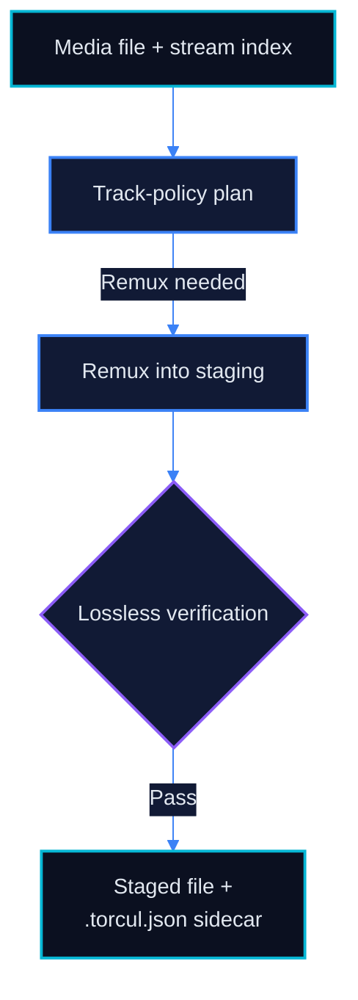

<!--
SPDX-FileCopyrightText: 2026 Lusoris <lusoris@pm.me>
SPDX-License-Identifier: EUPL-1.2
-->
<!-- markdownlint-disable MD013 MD033 MD041 -->

<div align="center">

  

  <!-- 3 security/scorecard -->
  [](SECURITY.md)
  [](https://coderabbit.ai)
  [](https://sourcery.ai)
  <!-- 4 standards -->
  [](AGENTS.md)
  [](REUSE.toml)
  [](CONTRIBUTING.md)
  <!-- 5 licence -->
  [](LICENSE)
  <!-- 6 support -->
  [](https://github.com/sponsors/lusoris)
  [](https://ko-fi.com/lusoris)

  **Video encoding and lossless track selection for media libraries.**

</div>

torcul is Vidiko’s video encode service. Its planned job takes one source stream and returns a verified encode or a verdict to keep the original. Today the [Rust CLI](crates/torcul-cli/src/args.rs) plans track selection, remuxes into staging and verifies the copy.

Pronounce *torcul* **TOR-kul** (/ˈtɔr.kʊl/). The name shortens Latin *torcular*, a wine or oil press, from *torquere*, “to twist”. Like the press, the encode service takes an input and aims to produce a smaller version of the same video stream. More in [the name section](docs/index.md#the-name) of the documentation home.

**[📖 Documentation](https://vidiko.github.io/torcul/)** · [Documentation source](docs/)

---

## 🎯 Why torcul

| Aspect | How torcul handles it |
| :--- | :--- |
| Track selection | Preview which audio and subtitle tracks to keep. The policy accounts for the original language and retains tracks of undetermined language with a warning. [Track policy](crates/torcul-policy/src/lib.rs) |
| Library originals | Library files stay untouched until the language-check and apply slice lands. The CLI copies selected tracks into staging. The verifier checks packet payloads, timing and metadata against the source before recording the verdict. [Verification](crates/torcul-media/src/verify.rs) · [Staging record](crates/torcul-cli/src/staging.rs) |
| Encode quality (planned) | Auto mode will choose a codec, encoder and rate control against a quality target and size budget. If no candidate meets both, torcul keeps the original. [Encode job design](docs/adr/0001-vmafx-integration.md) |
| Encoder workload (planned) | A test encode will check hardware availability. Remux, CPU encode and GPU encode will run in bounded pools. The encode plan accounts for geometry and HDR metadata. [Service design](docs/adr/0001-vmafx-integration.md) · [Pipeline](docs/adr/0002-pipeline-architecture.md) |

## 🚀 Get started

On Unix, install the [pinned Rust toolchain](rust-toolchain.toml), Clang, pkg-config and the FFmpeg development libraries (libavformat, libavcodec and libavutil). The [sample media generator](tools/fixtures/track_fixtures.py) needs Python 3 and the FFmpeg CLI with libx264. From the repository root, preview the track policy on the samples:

```sh
cargo build --locked
python3 -I tools/fixtures/track_fixtures.py target/fx
target/debug/torcul plan --meta target/fx/manifest.json --json target/plan.json target/fx
```

The table shows the stream indices to keep or drop for each file. To stage and verify one of them, follow the [track-policy CLI guide](docs/guides/track-policy-cli.md).

## 🧩 At a glance

The CLI reads stream indices from the media file. When the plan calls for a remux, it copies the selected streams into staging. Verification records the result beside the staged file. [ADR-0002, first slice](docs/adr/0002-pipeline-architecture.md#decision-17-first-slice)



## 📚 Guides and reference

- [Track-policy CLI](docs/guides/track-policy-cli.md) explains the metadata format, language rules, staging and verification.
- [Decision index](docs/adr/README.md) lists the accepted records and their status.
- [ADR-0001](docs/adr/0001-vmafx-integration.md) explains the choice of the VMAFx C interface for scoring.
- [ADR-0002](docs/adr/0002-pipeline-architecture.md) describes the media pipeline and the conditions for replacing a library file.

## 🤝 Contribute

Run `make verify-all` before submitting a change. The [contributor guide](CONTRIBUTING.md) covers tests and commit format. [AGENTS.md](AGENTS.md) defines repository standards. Report vulnerabilities privately through the [security policy](SECURITY.md).

## 💖 Support

Support torcul through [GitHub Sponsors](https://github.com/sponsors/lusoris) or [Ko-fi](https://ko-fi.com/lusoris).

## 📈 Roadmap and releases

torcul has no release yet. Follow [open issues](https://github.com/vidiko/torcul/issues) or browse work in the [0.1.0 milestone](https://github.com/vidiko/torcul/issues?q=milestone%3A0.1.0).

## Upstream and licence

The encode job contract began in ADR-3378 in [VMAFx](https://github.com/VMAFx/vmafx). torcul owns the service. Its planned integration calls the `libvmafx` C interface in process from Rust to score each candidate against the source, choose settings for a target score with `vmaf-tune auto`, and compare codecs and encoders. [ADR-0001](docs/adr/0001-vmafx-integration.md)

torcul uses the [European Union Public Licence 1.2](LICENSE). Per-file copyright and licence notices follow [REUSE](https://reuse.software). [REUSE configuration](REUSE.toml) · [Licence texts](LICENSES/)

## Standards and governance

torcul declares the High-Integrity Systems Standard (HISS-21) in [AGENTS.md](AGENTS.md). The `make verify-all` target in the [Makefile](Makefile) is the repository gate.

<!-- praetor:readme-governance:start -->
Praetor manages this repository's declared governance policy. This managed
block records adoption state; it is not a verification certificate.

**Verification**: `make verify-all` runs the repository's configured
verification cascade.

**HISS Audit**: `praetorctl audit` enforces policy, generated-surface
integrity, and the debt ratchet.

**Context Sync**: `praetorctl compile-context --verify` verifies every
generated agent context against `AGENTS.md`.

**Debt Baseline**: `.standards-baseline.json` anchors the debt ratchet at
0 recorded infractions; audit forbids growth.
<!-- praetor:readme-governance:end -->
